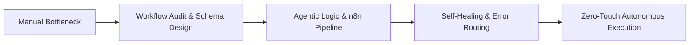

# Hi, I'm Aryan 👋
### AI Agent Architect & Business Automation Specialist

  <b>Transforming manual, repetitive business operations into autonomous, self-healing AI agent workflows.</b> 
  Specialized in custom <b>n8n architectures</b>, <b>multi-agent swarms</b>, <b>CRM/ERP integrations</b>, and <b>enterprise task automation</b>.

---

## ⚡ What I Do

I build intelligent automated infrastructure that helps businesses save 100+ hours every month, reduce human error to zero, and scale operations seamlessly:

- 🤖 **Autonomous AI Agent Workflows:** Designing autonomous multi-step agents that research, summarize, reason, call custom tools, and execute end-to-end tasks without human intervention.
- ⚙️ **Enterprise n8n Automation:** Building production-grade self-hosted & cloud n8n workflows with granular error routing, retry policies, webhooks, and sub-workflow modularity.
- 💬 **Conversational AI & Messaging Bots:** Production WhatsApp, Telegram, and Slack AI assistants connected to live databases, CRMs, and ticketing systems (e.g. [`whatsapp-ai-bot`](https://github.com/Boss17536/whatsapp-ai-bot)).
- 🔗 **Deep API & Tool Integrations:** Connecting fragmented SaaS stacks (HubSpot, Airtable, Notion, Stripe, Supabase, Google Workspace, custom REST/GraphQL APIs).
- 📊 **Intelligent Document & Data Extraction:** Automated processing of invoices, emails, leads, and unstructured data into clean, validated JSON schemas.

---

## 🛠️ Tech Stack & Automation Toolkit

<table>
  <tr>
    <td width="25%" valign="top"><b>Orchestration & Workflow</b></td>
    <td>
      
      
      
      
    </td>
  </tr>
  <tr>
    <td width="25%" valign="top"><b>Agentic AI & LLMs</b></td>
    <td>
      
      
      
      
      
    </td>
  </tr>
  <tr>
    <td width="25%" valign="top"><b>Languages & Backend</b></td>
    <td>
      
      
      
      
      
    </td>
  </tr>
  <tr>
    <td width="25%" valign="top"><b>Data & Cloud Infrastructure</b></td>
    <td>
      
      
      
      
      
    </td>
  </tr>
  <tr>
    <td width="25%" valign="top"><b>SaaS & Business Tools</b></td>
    <td>
      
      
      
      
      
    </td>
  </tr>
</table>

---

## 📈 Engineering & Workflow Philosophy

1. **Robustness Over Fragility:** Real-world APIs fail. Every automation includes circuit breakers, exponential backoff, dead-letter queues, and instant alert dispatches.
2. **Context-Aware AI:** No generic chatbot wrappers. Agents receive scoped tools, strict system schemas, and verifiable guardrails.
3. **Auditability & Observability:** Detailed execution logs, transaction tracking, and full transparency over every automated business decision.

---

## 📊 GitHub Analytics

  
  

---

## 🤝 Let's Build Something Autonomous

Looking to automate your business operations, streamline high-volume workflows, or deploy specialized AI agents?

- 💬 **Ask me about:** n8n, AI Agent architectures, custom API integrations, business automation strategy
- 📬 **Reach out:** [boss.927262@gmail.com](mailto:boss.927262@gmail.com)
- 🚀 **Always building:** Fast, reliable, and production-ready automated systems.
